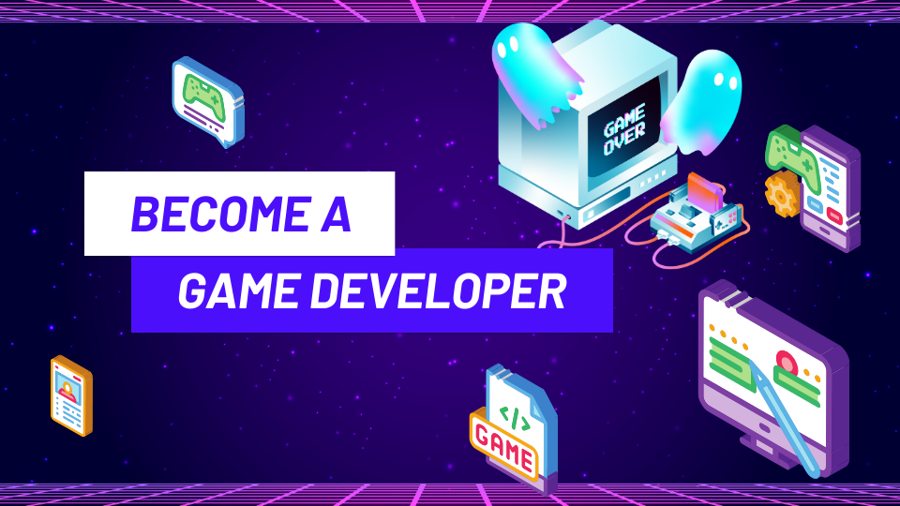

# Best Practices to Become a Game Programmer
 © Image from Zero to Mastery, “How to Become a Game Developer & Get Hired.”

Prepared for: Husky student pursuing a job as a game programmer

Prepared by: Iliya Hosseinisianaki

Date: 10/27/2026
## Table of Contents
- [Choose a specialization of game programmer](#choose-a-specialization-of-game-programmer)
- [Build up a technical foundation](#build-up-a-technical-foundation)
  - [Take courses outside of school](#take-courses-outside-of-school)
  - [Attend game jams](#attend-game-jams)
  - [Do internships](#do-internships)
- [Create personal projects](#create-personal-projects)
- [Build a tailored technical portfolio using past projects](#build-a-tailored-technical-portfolio-using-past-projects)

## Purpose
Almost everyone who applies to a game studio loves games, but far fewer can show they’re ready to build them. This guide walks you through four steps for closing that gap before you send a single resume: choosing a game programming specialization, developing the technical foundation that specialization demands, creating personal projects that put those skills to work, and turning your past projects into a portfolio tailored to the studio you want to join. The purpose of this guide is to help you show, not just say, that you’re ready to contribute to a game team, so your application stands out in a competitive field.

## Choose a specialization of game programmer
When you search through game studio job postings, you’ll rarely find an opening for a general game programmer. That’s because a game is built from several large technical systems, and each one requires its own deep knowledge. Gameplay, AI, rendering, tools, and the engine all solve very different kinds of problems, so studios write their postings around the specific system a team needs help with instead of around game programming as a whole. The main exception you’ll see is software engineering internships. Because of this, studios tend to favor candidates with real depth in one area over candidates who know a little about everything, so the applicants you’re up against will usually have focused on the same area you’re applying for.

Read real job postings for each specialization to learn what studios expect from the role. Pull up several entry-level and internship postings for gameplay, AI, rendering, tools, and engine programmers from studios such as Epic Games, Riot, and Blizzard, since these reflect what you’ll be expected to know when you graduate.

 (Placeholder image)

## Build up a specialized technical foundation

### Take courses on Coursera

### Attend game jams

### Do internships

## Create and publish personal projects

## Build a tailored technical portfolio using past projects

## References

<table>
  <tr>
    <td valign="top">[1]</td>
    <td>“Become a Game Developer” Zero To Mastery. Accessed: Oct. 27, 2026. [Online]. Available: https://zerotomastery.io/career-paths/become-a-game-developer/</td>
  </tr>
  <tr>
    <td valign="top">[2]</td>
    <td>“Epic Career Paths,” Epic Games. Accessed: Oct. 27, 2026. [Online]. Available: https://www.epicgames.com/site/earlycareers/career-paths?lang=en</td>
  </tr>
</table>

#### [Word count: 0]
