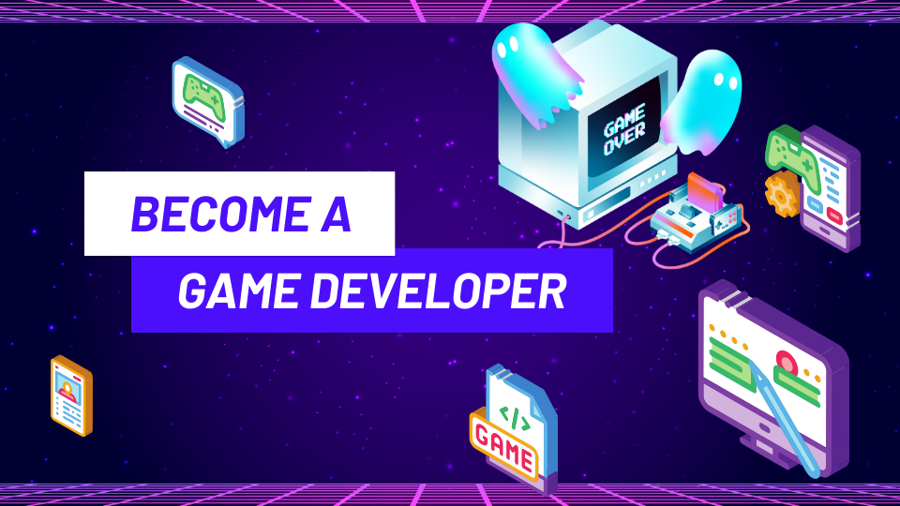
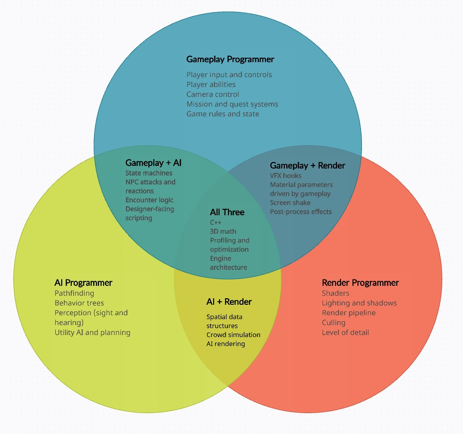

# Best Practices to Become a Game Programmer
 © Image from Zero to Mastery, “How to Become a Game Developer & Get Hired.”

Prepared for: Husky student pursuing a job as a game programmer

Prepared by: Iliya Hosseinisianaki

Date: 10/27/2026
## Table of Contents
- [Choose a specialization of game programmer](#choose-a-specialization-of-game-programmer)
- [Build up a technical foundation](#build-up-a-technical-foundation)
  - [Take courses outside of school](#take-courses-outside-of-school)
  - [Attend game jams](#attend-game-jams)
  - [Do internships](#do-internships)
- [Create personal projects](#create-personal-projects)
- [Build a tailored technical portfolio using past projects](#build-a-tailored-technical-portfolio-using-past-projects)

## Purpose
Almost everyone who applies to a game studio loves games, but far fewer can show they’re ready to build them. This guide walks you through four steps for closing that gap before you send a single resume: choosing a game programming specialization, developing the technical foundation that specialization demands, creating personal projects that put those skills to work, and turning your past projects into a portfolio tailored to the studio you want to join. The purpose of this guide is to help you show, not just say, that you’re ready to contribute to a game team, so your application stands out in a competitive field.

## Choose a specialization of game programmer
You won’t find open roles for general game programmer because a game is built from several large technical systems such as gameplay, AI, rendering, tools, and engine. All of them solve different kinds of problems, so studios write their postings around the specific system a team needs help with. The main exception you’ll see is software engineering internships. Because of this, studios tend to favor candidates with real depth in one area over candidates who know a little about everything.

The figure below compares three of these specializations (gameplay, AI, and render), showing what is unique to each and what they share. Compare the outer regions to decide where you want depth and use the overlaps to see which skills carry over if you change focus later. Find job postings and articles on other specializations if these don’t interest you. 
 © Venn diagram created on Creately

## Build up a specialized technical foundation

### Take courses on Coursera
Coursera provides you with courses that teach you programming languages that game studios require, and it works as a supplement for college courses. There are also courses that teach you how to use those programming skills you have learnt for specific game engines. These courses come from universities and companies such as Stanford and Google, so certifications of completing these courses from them are recognized by potential employers.

Choose courses in the language your target role uses, such as C++ or C#. After finishing one course of the targeted language, take the course that teaches how to use that language in a game engine such as using C++ in Unreal Engine or C# in Unity.

### Attend game jams
A game jam sets a theme and challenges you to create a fully functional game within a limited time frame. Participating in these jams tests your knowledge and abilities, and it helps teach you the importance of prioritizing a cohesive and finished product over an incomplete and ambitious one. The games you make for these game jams are also used for your portfolio. 

Prepare assets and placeholder prototypes before the jam, build the core mechanic first, and keep the team to four people or fewer with one named leader. Finish and polish the game afterward even if the deadline passes.

### Do internships at game studios
Doing internships at a game studio provides you a great learning experience and insight on how it feels to work in the industry, and how it feels making games as part of a larger team. It also helps improve your existing programming and problem-solving skills for future courses and interviews. 

Apply to multiple game studios such as Riot Games, Epic Games, and Blizzard. Tailor your application to fit the requirements and the studio you are applying to. 

## Create and publish games using game engines
Creating a game on a game engine gives you experience working with that engine, so employers wouldn’t have to spend time training you on it. You also improve your skills creating a game. These games are also used for portfolios. 

Release small, finished projects in the engine your target studio uses, such as Unreal Engine for Epic, and pick a project that exercises your chosen specialization, such as enemy behavior for an AI focus. Publish finished projects on itch.io, Steam, or GameJolt.

## Build a tailored technical portfolio using past projects
A degree shows knowledge, but employers want proven work and the ability to explain the process, and the best portfolios feature work relevant to the studio.

Select past projects that match the studio’s genre and engine, such as racing games for a racing focused studio, and lead with the strongest. Add notes stating which parts you built yourself and test every build until no glitches remain.

## References

<table>
  <tr>
    <td valign="top">[1]</td>
    <td>“Become a Game Developer” Zero To Mastery. [Online]. Available: https://zerotomastery.io/career-paths/become-a-game-developer/. [Accessed: Oct. 27, 2026]</td>
  </tr>
  <tr>
    <td valign="top">[2]</td>
    <td>“Venn Diagram Maker” Creately. [Online]. Available: https://creately.com/lp/venn-diagram-maker/. [Accessed: Nov. 4, 2026]</td>
  </tr>
  <tr>
    <td valign="top">[3]</td>
    <td>“Epic Career Paths,” Epic Games. [Online]. Available: https://www.epicgames.com/site/earlycareers/career-paths?lang=en. [Accessed: Oct. 27, 2026]</td>
  </tr>
</table>

#### [Word count: 685]
