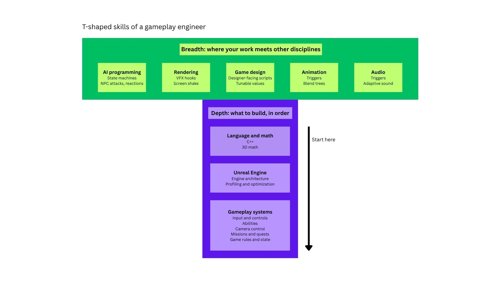

# Best Practices to Become a Gameplay Engineer
 © Image from Zero to Mastery, “How to Become a Game Developer & Get Hired.”[^1]

**Prepared for:** Husky student pursuing a job as a gameplay engineer

**Prepared by:** Iliya Hosseinisianaki

**Date:** 10/27/2026
## Table of Contents
- [Purpose](#purpose)
- [Understanding the role](#understanding-the-role)
- [Building up a specialized technical foundation](#building-up-a-specialized-technical-foundation)
  - [Taking courses on Coursera](#taking-courses-on-coursera)
  - [Attending game jams](#attending-game-jams)
  - [Doing internships at game studios](#doing-internships-at-game-studios)
- [Creating and publishing games using game engines](#creating-and-publishing-games-using-game-engines)
- [Building a tailored technical portfolio using past projects](#building-a-tailored-technical-portfolio-using-past-projects)
- [References](#references)

## Purpose
Almost everyone who applies to a game studio loves games, but far fewer can show they’re ready to build them. This guide walks you through four steps for closing that gap before you send a single resume: understanding what a gameplay engineer does, developing the technical foundation that specialization demands, creating personal projects that put those skills to work, and turning your past projects into a portfolio tailored to the studio you want to join. The purpose of this guide is to help you show, not just say, that you’re ready to contribute to a game team, so your application stands out in a competitive field.

## Understanding the role
Understanding what a gameplay engineer does matters because game programming covers several specializations, each with their own set of skills.[^2] Without knowing the exact skills you need, you might spend months learning about shaders or pathfinding, which belong to rendering and AI programmers, and still lack the skills a gameplay job asks for.[^2] Studios like Epic set specific requirements for early-career programmers, including strong C++ and familiarity with Unreal Engine, and a strong math background is an added benefit.[^3] Programmers are also expected to work closely with designers and artists.[^2]

Go deep on gameplay systems and stay broad only where they meet AI, rendering, and design. Figure 1 shows this as a T: the vertical stem holds the skills to learn in depth, and the horizontal bar holds the neighboring fields, where you need only the part that touches your own code.

Figure 1: T-shaped skills of a gameplay engineer

 © Diagram made using Canva

## Building up a specialized technical foundation

### Taking courses on Coursera
Coursera provides you with courses that teach you programming languages that game studios require, and it works as a supplement for college courses. There are also courses that teach you how to use those programming skills you have learnt for specific game engines. These courses come from universities and companies such as Stanford and Google,[^4] so certifications of completing these courses from them are recognized by potential employers.

Take a C++ course and a 3D math course first, such as Codio's Programming in C++: A Hands-on Introduction[^5] and Packt's Vectors and Intersections in Game Development,[^6] then the course that teaches how to use C++ in Unreal Engine, such as the University of Colorado's C++ Programming for Unreal Game Development.[^7]

### Attending game jams
A game jam sets a theme and challenges you to create a fully functional game within a limited time frame. Participating in these jams tests your knowledge and abilities, and it helps teach you the importance of prioritizing a cohesive and finished product over an incomplete and ambitious one. The games you make for these game jams are also used for your portfolio.[^8]

Prepare assets and placeholder prototypes before the jam, build the core mechanic first, and keep the team to four people or fewer with one named leader. Finish and polish the game afterward even if the deadline passes.[^8]

### Doing internships at game studios
Doing internships at a game studio provides you a great learning experience and insight on how it feels to work in the industry, and how it feels making games as part of a larger team. It also helps improve your existing programming and problem-solving skills for future courses and interviews.[^9]

Apply to multiple game studios such as Riot Games, Epic Games, and Blizzard. Tailor your application to fit the requirements and the studio you are applying to.[^9]

## Creating and publishing games using game engines
Creating a game on a game engine gives you experience working with that engine, so employers wouldn’t have to spend time training you on it. You also improve your skills creating a game. These games are also used for portfolios.[^10]

Release small, finished projects in Unreal Engine that exercise the gameplay systems in Figure 1, such as a player ability or third-person camera. Show documentation of each project on GitHub[^3] and publish it on itch.io.[^10]

## Building a tailored technical portfolio using past projects
A degree shows knowledge, but employers want proven work and the ability to explain the process, and the best portfolios feature work relevant to the studio.[^10]

Select past projects that match the studio’s genre and engine, such as racing games for a racing focused studio, and lead with the strongest. Add notes stating which parts you built yourself and test every build until no glitches remain.[^10]

#### [Word count: 675]

## References

[^1]: Zero To Mastery, “Become a Game Developer”, *Zero To Mastery*, n.d. [Online]. Available: https://zerotomastery.io/career-paths/become-a-game-developer/. [Accessed Oct. 27, 2026].

[^2]: Toptal, “Hire Game Developers”, *Toptal*, n.d. [Online]. Available: https://www.toptal.com/xna. [Accessed Nov. 25, 2026].

[^3]: Epic Games, “Epic Career Paths”, *Epic Games*, n.d. [Online]. Available: https://www.epicgames.com/site/earlycareers/career-paths?lang=en. [Accessed Oct. 27, 2026].

[^4]: Jennifer Inglis, “Coursera vs Udemy: Which Should You Choose?”, *Course Report*, 15 September 2026. [Online]. Available: https://www.coursereport.com/blog/coursera-vs-udemy-which-should-you-choose. [Accessed Nov. 4, 2026].

[^5]: Codio, “Programming in C++: A Hands-on Introduction”, *Coursera*, n.d. [Online]. Available: https://www.coursera.org/specializations/hands-on-cpp. [Accessed Nov. 25, 2026].

[^6]: Packt, “Vectors and Intersections in Game Development”, *Coursera*, n.d. [Online]. Available: https://www.coursera.org/learn/packt-vectors-and-intersections-in-game-development-jhnbc. [Accessed Nov. 25, 2026].

[^7]: University of Colorado System, “C++ Programming for Unreal Game Development”, *Coursera*, n.d. [Online]. Available: https://www.coursera.org/specializations/cplusplusunrealgamedevelopment. [Accessed Nov. 25, 2026].

[^8]: Pavel Bokai-Poltavetz and Dmitry Osipov, “How to get maximum benefit (and fun) from participating in a game jam”, *Game Developer*, 26 September 2024. [Online]. Available: https://www.gamedeveloper.com/production/how-to-get-maximum-benefit-and-fun-from-participating-in-a-game-jam. [Accessed Nov. 4, 2026].

[^9]: Prisha Gellaboina, “Placement Experience: Software Engineer at Criterion Games (EA)”, *University of Portsmouth*, 2 March 2021. [Online]. Available: https://www.port.ac.uk/news-events-and-blogs/blogs/study-and-student-life/placement-experience-software-engineer-intern-criterion-games. [Accessed Nov. 4, 2026].

[^10]: Targetjobs Editorial Team, “I want to work as a video game developer – part 2: how to get hired”, *targetjobs*, 25 January 2023. [Online]. Available: https://targetjobs.co.uk/careers-advice/creative-arts-media-and-design/i-want-work-video-game-developer-part-2-how-get-hired. [Accessed Nov. 4, 2026].
